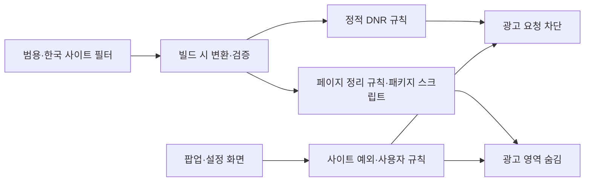

# 크롬 광고 차단 확장프로그램 기획서

- 작성일: 2026-09-30
- 프로젝트 가칭: 클린웹
- 대상: 데스크톱 Chrome의 일반 웹페이지
- 문서 상태: v0.1.0 MVP 구현 완료. 설치 및 빌드는 [README.md](README.md), 실제 검증 범위와 남은 출시 기준은 [VALIDATION.md](VALIDATION.md) 참조.

## 1. 목표와 권장 방향

웹페이지가 제공하는 광고 요청을 차단하고, 화면에 남은 광고 영역과 불필요한 빈 공간을 정리하는 확장프로그램을 만든다.

**권장 방식은 uBlock Origin Lite(uBOL)를 기반으로 한국 사이트 대응 규칙과 간단한 한국어 UI를 추가하는 것이다.** 기존 차단 엔진과 요소 선택 기능을 활용하고, 국내 사이트에서의 차단 완성도와 복구 편의성에 개발을 집중한다.

제품의 핵심 경험은 다음과 같다.

1. 설치하면 일반적인 배너 광고가 자동으로 차단된다.
2. 남은 광고는 사용자가 직접 선택해 숨길 수 있다.
3. 사이트가 이상해지면 해당 사이트의 차단을 끄고 복구할 수 있다.
4. 게시글, 검색, 로그인 등 사이트의 핵심 기능은 유지된다.

첫 검증 대상은 사용자가 첨부한 디시인사이드 화면으로 정한다. 범용 광고 차단을 제공하면서 국내 사이트 5~10개를 별도로 검증하는 방향이다.

## 2. 오픈소스 레퍼런스

| 프로젝트 | 역할과 참고할 부분 | 활용 방안 |
| --- | --- | --- |
| [uBlock Origin Lite](https://github.com/uBlockOrigin/uBOL-home) | MV3 기반 콘텐츠 차단 확장프로그램 | 개발 기반으로 채택하고 특정 소스 버전을 고정 |
| [uBOL 실제 소스](https://github.com/gorhill/uBlock/tree/master/platform/mv3) | 필터 빌드, 규칙 관리, 콘텐츠 스크립트, 요소 선택 UI | 기존 동작을 재사용하고 한국 사이트 규칙 및 UI 추가 |
| [AdGuard Browser Extension](https://github.com/AdguardTeam/AdguardBrowserExtension) | 필터 관리, 설정, 사이트 예외 처리 | 복구 흐름과 설정 UX 참고 |
| [AdGuard 필터 라이브러리](https://github.com/AdguardTeam/tsurlfilter) | 필터 파싱, DNR 변환, 확장프로그램 통합 | 독립 구현을 선택해야 할 경우의 대안 |
| [EasyList](https://github.com/easylist/easylist) | 범용 광고 필터 | 글로벌 광고 네트워크와 일반 배너 대응 |
| [YousList](https://github.com/yous/YousList) | 한국 사이트 중심 광고 필터 | 호환성 검증 후 국내 사이트 규칙에 활용 |
| [List-KR](https://github.com/List-KR/List-KR) | 한국어 사이트 광고 필터 | 호환성 검증 및 사이트별 대응 규칙 참고 |

### 참고할 소스 위치

- [`platform/mv3/make-rulesets.js`](https://github.com/gorhill/uBlock/blob/master/platform/mv3/make-rulesets.js): 필터 목록을 배포용 규칙으로 변환하는 빌드 과정.
- [`ruleset-manager.js`](https://github.com/gorhill/uBlock/blob/master/platform/mv3/extension/js/ruleset-manager.js): 네트워크 규칙 관리.
- [`scripting-manager.js`](https://github.com/gorhill/uBlock/blob/master/platform/mv3/extension/js/scripting-manager.js): 콘텐츠 필터링용 스크립트 등록 관리.
- [`picker-ui.js`](https://github.com/gorhill/uBlock/blob/master/platform/mv3/extension/js/picker-ui.js): 사용자가 화면 요소를 선택해 차단하는 UI.
- [`chromium/manifest.json`](https://github.com/gorhill/uBlock/blob/master/platform/mv3/chromium/manifest.json): Chrome 패키지의 권한과 진입점.
- [AdGuard DNR Converter](https://github.com/AdguardTeam/tsurlfilter/blob/master/packages/dnr-converter/README.md): 지원하는 필터 문법과 DNR 변환 한계.
- [AdGuard API MV3](https://github.com/AdguardTeam/tsurlfilter/blob/master/packages/adguard-api-mv3/README.md): 독립 확장프로그램 통합 예시.

현재 uBOL은 사용자 필터와 외부 필터 구독을 지원한다. 과거 자료의 기능 제한을 그대로 전제하지 않고 채택한 버전의 실제 기능을 확인한다. 근거: [uBOL 공식 FAQ](https://github.com/uBlockOrigin/uBOL-home/wiki/Frequently-asked-questions-%28FAQ%29).

### 개발 방식 비교

| 방식 | 장점 | 부담 | 판단 |
| --- | --- | --- | --- |
| uBOL 기반 수정 | 기존 차단·요소 선택·예외 기능 활용, 초기 구현량 감소 | 업스트림 변경 추적, 기존 빌드 이해, GPL 조건 준수 | **첫 버전에 권장** |
| AdGuard 라이브러리 기반 독립 구현 | 자체 UI와 구조 설계에 자유로움 | 패키지 통합, 리소스 및 규칙 빌드, 초기 검증 범위 증가 | 대안 |
| 엔진과 필터 변환기 직접 개발 | 구현 전반을 직접 통제 | 필터 문법, 예외, 성능, 호환성 유지보수 부담이 큼 | 첫 버전에서는 채택하지 않음 |

uBOL 기반 경로에서는 기존 빌드 체계를 우선 유지한다. 새 프레임워크나 빌드 도구 도입은 필요한 경우에만 검토한다.

## 3. Chrome 제약과 설계 원칙

### Manifest V3

최신 Chrome을 대상으로 Manifest V3로 개발한다. Manifest V2를 전제로 한 구현은 채택하지 않는다. Chrome 공식 문서상 Chrome 139 이후에는 Manifest V2 확장프로그램이 동작하지 않는다.

근거: [Manifest V2 지원 일정](https://developer.chrome.com/docs/extensions/develop/migrate/mv2-deprecation-timeline).

### 네트워크 차단과 화면 정리를 함께 제공

- 네트워크 차단: `chrome.declarativeNetRequest`(DNR) 규칙으로 광고 요청을 차단한다.
- 화면 정리: CSS와 콘텐츠 스크립트로 광고 컨테이너 및 불필요한 빈 공간을 숨긴다.
- 같은 사이트에서 정상 콘텐츠와 광고가 함께 제공되면 사이트별 조건과 선택자를 사용한다.
- 광고 차단 후 전체 페이지 레이아웃을 일괄 재배치하지 않고, 확인된 광고 영역만 정리한다.

근거: [Chrome DNR API](https://developer.chrome.com/docs/extensions/reference/api/declarativeNetRequest).

### 규칙 예산과 필터 호환성

정적 DNR 규칙은 확장프로그램에 포함한다. 사용자 네트워크 규칙과 사이트 예외는 필요한 범위에서 동적 규칙으로 관리한다.

Chrome은 정적 규칙에 최소 30,000개를 보장하지만 추가 용량은 브라우저 내 다른 확장프로그램의 사용량 등에 영향을 받는다. 필터를 무제한 추가하는 방식으로 설계하지 않는다.

- 중복 규칙과 불필요한 규칙을 줄인다.
- 빌드 결과에 생성 규칙 수, 변환 실패 수, 제외 사유를 남긴다.
- 설치 및 필터 활성화 시 가용 규칙 수를 확인한다.
- 규칙 한도 때문에 필터가 적용되지 않으면 사용자에게 상태를 알린다.
- 필터의 차단 규칙과 예외 규칙을 함께 검증한다.

List-KR은 공식적으로 AdGuard와 uBlock Origin을 지원하며, 일부 고급 규칙은 코드 실행을 요구한다. MV3에서 모든 규칙이 동일하게 동작한다고 가정하지 않는다. 커뮤니티 List-KR과 AdGuard 측 포크는 운영 경로가 다르므로 출처 저장소, 버전, 변환 결과를 기록한다.

근거: [List-KR README](https://github.com/List-KR/List-KR), [운영 변경 공지](https://github.com/List-KR/List-KR/issues/1109), [AdGuard DNR 변환 한계](https://github.com/AdguardTeam/tsurlfilter/blob/master/packages/dnr-converter/README.md).

### 업데이트와 실행 코드

첫 버전의 기본 필터와 사이트별 스크립트는 빌드 시 패키지에 포함하고 확장프로그램 업데이트로 배포한다. 외부 필터 구독 및 별도 필터 데이터 업데이트는 후속 범위로 둔다.

실행할 JavaScript와 WASM은 패키지에 포함한다. 외부 필터 데이터 업데이트를 추가하더라도 데이터와 실행 코드를 구분하고, 원격 문자열을 임의의 코드로 실행하지 않는다.

근거: [Chrome 원격 코드 정책](https://developer.chrome.com/docs/extensions/develop/migrate/remote-hosted-code).

## 4. 첫 버전 기능 범위

| 우선순위 | 기능 | 요구사항 |
| --- | --- | --- |
| 필수 | 자동 광고 요청 차단 | 일반 광고 이미지·스크립트·iframe 요청 차단 |
| 필수 | 광고 영역 정리 | 확인된 광고 컨테이너와 불필요한 빈 공간 숨김 |
| 필수 | 직접 선택해 숨기기 | 요소 선택, 적용 미리보기, 저장, 취소 |
| 필수 | 사이트별 켜기·끄기 | 네트워크 차단과 화면 정리를 함께 전환하고 새로고침 안내 |
| 필수 | 사용자 규칙 관리 | 저장한 항목 목록, 개별 삭제, 사이트별 초기화 |
| 필수 | 한국 사이트 필터 | 검증된 국내 사이트 규칙 기본 제공 |
| 필수 | 설정 유지 | 재시작 및 확장프로그램 업데이트 후 사용자 설정 보존 |
| 후속 | 규칙 내보내기·가져오기 | 사용자 설정 및 규칙 백업 |
| 후속 | 외부 필터 구독 | 호환성, 업데이트 실패, 규칙 한도 처리까지 포함 |
| 후속 | 문제 제보 | 사용자가 내용을 확인한 후 직접 제출하는 흐름 |
| 별도 검증 | 영상 광고·차단 감지 대응 | YouTube 등 서비스별 제약과 유지보수 비용을 확인한 뒤 범위 결정 |

첫 버전은 일반 웹페이지의 배너·고정 광고·광고 iframe에 집중한다. 모든 사이트와 모든 광고를 완전히 차단한다는 보장은 제품 목표로 삼지 않는다.

## 5. 첨부 화면을 기준으로 한 초기 검증

| 대상 | 처리 계획 | 확인 사항 |
| --- | --- | --- |
| 좌측 세로 Adobe 배너 | 광고 요청 차단 및 배너 컨테이너 숨김 | 게시판 본문 위치와 폭이 깨지지 않는지 |
| 우측 하단 고정 Adobe 광고 | 고정 광고 컨테이너 숨김 | 지연 로딩·스크롤 후 다시 삽입되는지 |
| 화면 아래쪽 가로 배너 | 광고 요청 차단 및 남은 영역 정리 | 검색창·페이지 이동 영역이 유지되는지 |
| 글 목록·검색·페이지 이동·글쓰기 | 정상 기능 보존 | 클릭 및 이동 기능이 차단되지 않는지 |
| 우측 디시미디어·디시이슈 | 기본 자동 제거 대상에서 제외 | 사용자가 원하면 직접 숨길 수 있는지 |

스크린샷만으로 실제 광고 URL이나 HTML 선택자를 확정할 수 없다. 구현 단계에서 실제 DOM과 네트워크 요청을 조사한다. 콘텐츠처럼 보이는 추천 영역은 광고 여부가 확인되기 전까지 자동 제거하지 않는다.

광고주 이름이나 `ad` 문자열이 포함된 모든 요소를 숨기는 식의 광범위한 규칙은 피한다. 사이트와 광고 컨테이너를 특정하고, 정상 게시글·이미지·버튼이 유지되는지 확인한다.

## 6. 사용자 흐름과 UI

### 팝업

```text
클린웹
gal.dcinside.com

현재 사이트 광고 차단  [켜짐]

[남은 광고 숨기기]
[내가 숨긴 항목 관리]
[이 사이트에서 차단 끄기]

한국 사이트 필터: 사용 중
[설정]
```

### 직접 숨기기

1. 팝업에서 `남은 광고 숨기기`를 누른다.
2. 페이지에서 대상 요소를 가리키면 강조 표시한다.
3. 클릭하면 숨김 결과를 미리 보여준다.
4. 사용자가 저장하면 해당 사이트에 한정한 규칙을 기록한다.
5. 취소하거나 Esc를 누르면 선택 모드를 종료한다.
6. 저장한 항목은 관리 화면에서 삭제해 복구할 수 있다.

선택자 후보가 지나치게 넓어 정상 콘텐츠까지 포함하면 저장 전 범위를 다시 확인하도록 한다. 가능한 한 안정적인 속성과 사이트별 범위를 사용하고, DOM 순서만으로 만든 취약한 선택자는 줄인다.

### 사이트 복구

사이트 차단을 끄면 해당 사이트의 네트워크 차단과 화면 정리를 함께 해제한다. 이미 차단된 요청과 페이지 상태를 복구하기 위해 새로고침을 제공한다. 상태 변경이 완료되기 전에는 UI에서 완료로 표시하지 않는다.

설정 화면은 기본 필터, 사이트 예외, 사용자 규칙, 초기화, 오픈소스 고지로 구성한다.

## 7. 기술 구조와 데이터



| 구성요소 | 책임 |
| --- | --- |
| 필터 빌드 | 소스 버전 고정, 규칙 변환, 중복 정리, 실패 보고 |
| DNR 관리 | 기본 필터 활성화, 사용자 네트워크 규칙 및 예외 적용 |
| 페이지 정리 | 사이트별 CSS·패키지 스크립트 적용, 사용자 숨김 규칙 처리 |
| 서비스 워커 | 설정 변경, 규칙 변경, 메시지 처리 |
| 팝업·설정 | 사이트 상태, 요소 선택 시작, 규칙 관리, 복구 |
| 로컬 저장소 | 사용자 설정, 사이트 예외, 사용자 규칙, 데이터 버전 |

기본 차단은 서비스 워커가 잠들어 있어도 동작하도록 기존 선언형 구조를 유지한다. 동적으로 추가되는 광고 처리가 필요한 경우 기존 엔진을 우선 활용하고, 추가 DOM 관찰은 대상 범위를 제한해 설계한다.

### 저장할 데이터

- 전역 활성화 상태 및 필터 선택.
- 사이트별 예외. 호스트 단위인지 하위 도메인을 포함하는지 UI와 규칙에서 일관되게 처리.
- 사용자 규칙의 ID, 적용 사이트, 규칙 내용, 활성화 상태, 생성 시각.
- 설정 스키마 버전과 필터 빌드 버전.

계정과 자체 서버는 첫 버전에 필요하지 않다. 설정과 사용자 규칙은 로컬에 저장하고, 방문 기록이나 페이지 내용을 외부로 전송하지 않는 구조로 설계한다.

## 8. 권한과 배포

채택한 uBOL 버전의 manifest를 기준으로 각 권한과 실제 사용하는 기능을 대조한다. 권한을 임의로 삭제해 기존 기능을 깨뜨리지 않도록 한다.

- 네트워크 차단용 DNR 권한.
- 설정 저장용 저장소 권한.
- 페이지 정리와 요소 선택에 필요한 스크립트 및 사이트 접근 권한.
- 채택 버전의 추가 권한은 사용하는 기능과 연결해 필요성을 기록.

페이지 내용을 정리하기 위해 사이트 접근 권한이 필요하다는 점을 사용자에게 설명한다. 권한이 없는 사이트에서는 가능한 차단 범위와 상태를 명확하게 표시한다.

개발 중에는 압축해제 확장프로그램으로 검증하고, 공개 배포는 Chrome Web Store용 패키지로 준비한다. 별도 제품명·아이콘을 사용하고 원본 프로젝트와의 관계 및 라이선스를 고지한다. 스토어 공개는 구현과 검증을 마친 후의 별도 단계다.

## 9. 구현 일정과 작업 순서

개발자 1명, uBOL 기반, 스토어 심사 기간 제외의 초기 추정이다. 합계는 약 10~17 개발일이며 실제 빌드 재현과 사이트 조사 결과에 따라 조정한다.

| 단계 | 예상 | 작업 | 완료 결과 |
| --- | --- | --- | --- |
| 1. 기반 확보 | 1~2일 | 소스 버전 고정, 빌드 재현, 별도 이름·아이콘 적용 | Chrome에 로드 가능한 패키지와 재현 가능한 빌드 |
| 2. 디시인사이드 대응 | 2~4일 | 기존 필터 효과 확인, DOM·요청 조사, 보완 규칙 작성 | 첨부 화면 광고 처리 및 핵심 기능 보존 |
| 3. 사용성 정리 | 2~3일 | 한국어 팝업, 직접 숨기기, 규칙 관리, 복구 흐름 | 사용자 조작과 재시작 후 설정 유지 |
| 4. 국내 사이트 확장 | 3~5일 | 뉴스·커뮤니티 등 5~10개 사이트 회귀 검증 | 사이트별 검증 목록과 결과 |
| 5. 배포 준비 | 2~3일 | 패키지 검증, 권한 설명, 오픈소스·개인정보 문서 | 검토 가능한 배포 후보 패키지 |

첫 작업은 **uBOL 빌드 재현 → 디시인사이드에서 기존 필터로 남는 광고 확인 → 사이트별 보완 규칙 작성** 순서로 진행한다. 변경 사항을 최소화해 업스트림 업데이트를 계속 반영할 수 있도록 한다.

## 10. 검증 및 출시 기준

아래 수치는 전체 출시 목표다. v0.1.0에서 측정한 결과는 [VALIDATION.md](VALIDATION.md)에 별도로 기록하며, 제한된 샘플 검증을 전체 사이트의 통과로 해석하지 않는다.

| 항목 | 통과 기준 | 검증 방법 |
| --- | --- | --- |
| 광고 제거 | 검증 페이지에서 사전에 식별한 광고 슬롯의 90% 이상 제거 | 동일한 페이지·상태의 차단 전후 화면 및 요청 비교 |
| 정상 기능 | 지정한 핵심 사용 흐름에서 오류 0건 | 게시글 열기, 검색, 페이지 이동, 로그인 등 수동·자동 확인 |
| 지연 삽입 광고 | 지정한 지연 로딩·스크롤 시나리오에서 처리 유지 | 로드 직후와 대기·스크롤 후 비교 |
| 사용자 규칙 | 새로고침·Chrome 재시작 후 유지 | 요소 숨김 저장 후 재접속 |
| 복구 | 사이트 차단 해제 및 새로고침 후 정상 콘텐츠 복구 | 네트워크 차단과 화면 정리 모두 해제 확인 |
| 서비스 워커 | 워커 중단 후에도 기본 차단 동작 | 개발자 도구에서 워커 상태를 확인하며 재접속 |
| 규칙 적용 | 활성 필터의 오류·미적용을 숨기지 않음 | 변환 결과, 활성 규칙, 예외 우선순위 확인 |
| 업데이트 | 사용자 설정 보존 | 버전 업데이트 후 필터 선택·예외·사용자 규칙 확인 |

광고 제거율의 분모는 차단 전 페이지에서 확인한 광고 슬롯이다. 광고 소재가 표시되지 않은 빈 슬롯과 아직 광고 여부가 확인되지 않은 추천 콘텐츠를 임의로 광고로 집계하지 않는다.

성능은 차단 전후 로딩 시간과 페이지 정리 처리 비용을 비교한다. 초기 샘플에서 기준값을 측정한 뒤 성능 통과 기준을 구체화한다. 지속적인 전체 DOM 재탐색이나 불필요한 서비스 워커 깨우기를 피한다.

실제 사이트 검증에서는 다른 광고 차단 확장프로그램의 영향을 분리한다. 개발용 상세 규칙 로그는 배포판과 구분한다. DNR의 `onRuleMatchedDebug`는 압축해제 확장프로그램용 디버깅 기능이므로 배포판의 필수 기능으로 의존하지 않는다.

근거: [Chrome DNR API의 디버깅 이벤트](https://developer.chrome.com/docs/extensions/reference/api/declarativeNetRequest#event-onRuleMatchedDebug).

## 11. 유지보수와 주요 위험

| 위험 | 대응 |
| --- | --- |
| 사이트의 광고 주소·DOM 변경 | 사이트별 규칙을 분리하고 대표 페이지 회귀 검증 |
| 정상 콘텐츠 오차단 | 도메인·경로·요소 범위 제한, 예외 규칙, 빠른 복구 UI |
| 필터 문법의 MV3 비호환 | 변환 실패 보고, 지원 가능한 규칙만 채택, 필요 시 패키지 스크립트 검토 |
| DNR 규칙 한도 | 중복 제거, 가용량 확인, 필터 활성화 실패 표시 |
| 업스트림 변경 | 버전 고정, 변경 사항 최소화, 업데이트 후 회귀 검증 |
| 영상 광고 및 차단 감지의 잦은 변경 | 첫 버전과 별도 범위로 관리 |
| 기본 필터의 업데이트 지연 | 패키지 릴리스 절차를 자동화하고, 후속으로 데이터 업데이트 방식 검토 |

각 사이트 보완 규칙에 대상 사이트, 작성 이유, 정상 기능 확인 결과를 기록한다. 필터 출처와 버전을 남겨 문제 발생 시 이전 버전으로 되돌릴 수 있게 한다.

## 12. 라이선스와 고지

| 출처 | 조사 시 확인한 라이선스 | 배포 준비 사항 |
| --- | --- | --- |
| uBOL / uBlock Origin | GPLv3 계열 | 채택한 버전의 조건에 따른 소스 제공, 라이선스 및 저작권 고지 |
| AdGuard 확장프로그램·필터 라이브러리 | GPLv3 계열 | 실제 사용한 패키지와 파일의 조건 확인 및 고지 |
| List-KR | GPLv3 | 필터 출처와 사용·변환 내역 고지 |
| YousList | CC BY 4.0 | 저작자·출처·라이선스 및 변경 사항 표시 |
| EasyList | GPLv3 이상 또는 CC BY-SA 3.0 이상 선택 가능 | 실제 포함 파일의 조건과 적용 라이선스 확인 및 고지 |

코드 라이선스와 필터 데이터 라이선스를 각각 기록한다. 수정본을 공개 배포할 때는 해당 버전의 원문 라이선스에 맞춰 소스 제공 및 고지 절차를 준비한다.

근거: [uBOL LICENSE](https://github.com/uBlockOrigin/uBOL-home/blob/main/LICENSE), [AdGuard 라이브러리](https://github.com/AdguardTeam/tsurlfilter), [List-KR 라이선스](https://github.com/List-KR/List-KR#라이선스), [YousList 라이선스](https://github.com/yous/YousList#license), [EasyList 라이선스 안내](https://easylist.to/pages/licence.html).

## 13. 구현 시작 시 확정할 사항

- 채택할 uBOL 릴리스와 소스 커밋.
- 기존 빌드를 재현할 환경 및 배포 자동화 방법.
- 기본 활성화할 한국 필터와 실제 MV3 변환 결과.
- 디시인사이드 광고의 실제 URL·DOM 선택자 및 회귀 검증 페이지.
- 초기 검증할 나머지 국내 사이트 목록.
- 채택 버전에서 필요한 권한과 최소 Chrome 버전.
- 첫 성능 측정 결과에 기반한 수치 기준.

이 항목들은 초기 기획에서 구현 단계 조사 대상으로 정한 사항이다. 실제 확정값은 아래 구현 결과와 검증 문서에 기록한다. 성능 기준과 전체 출시 검증은 아직 남아 있다.

## 14. v0.1.0 구현 결과

| 구분 | 구현 결과 |
| --- | --- |
| 기반 | uBOL 원본 2026.926.2202 및 정확한 커밋·하위 모듈을 고정 |
| 빌드 | Windows용 Node 빌드. 고정 원본 패키지에 별도 UI 추가, 추가 한국 필터는 원본 변환기로 재생성 |
| 한국 필터 | YousList 기본 활성화, 디시인사이드 보완 필터 추가 |
| 사용자 기능 | 한국어 팝업·설정, 사이트별·전체 차단, 직접 숨기기, 검색·삭제·취소·초기화 |
| 데이터 | 원본 엔진의 호스트·선택자 저장 구조 유지. 별도 규칙 ID·생성 시각은 MVP에 추가하지 않음 |
| 검증 | 국내 6개 사이트 기본 화면 및 디시 광고 영역 4개, 복구·재시작·버전 변경·워커 중단 검사 |
| 전달물 | 압축해제 설치 폴더, 설치 ZIP, 대응 소스 ZIP, SHA-256, 설치·개인정보·출처·검증 문서 |
| 남은 출시 작업 | 게시글·검색·로그인 등 전체 사용자 흐름, 성능 정량 비교, 스토어 심사 및 공개 |

실제 설치와 개발 명령은 [README.md](README.md), 검증 수치와 한계는 [VALIDATION.md](VALIDATION.md) 참조. 제한된 샘플의 결과를 전체 사이트에 대한 광고 제거 보장으로 확장하지 않는다.
